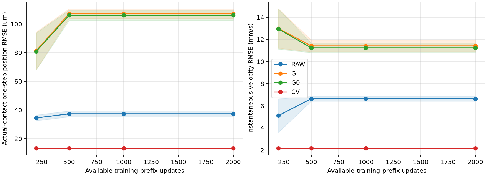
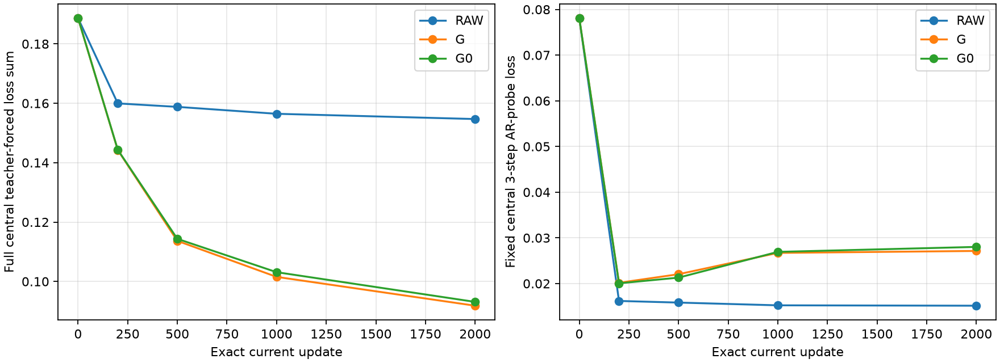
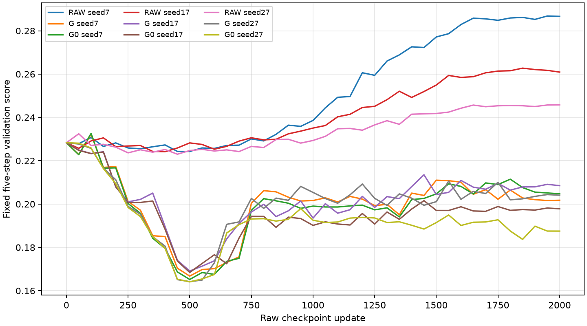
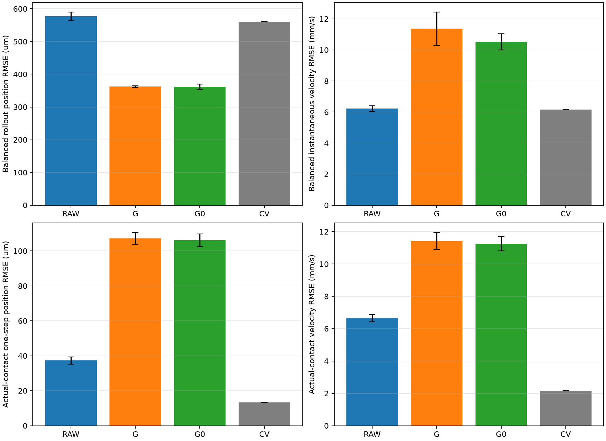
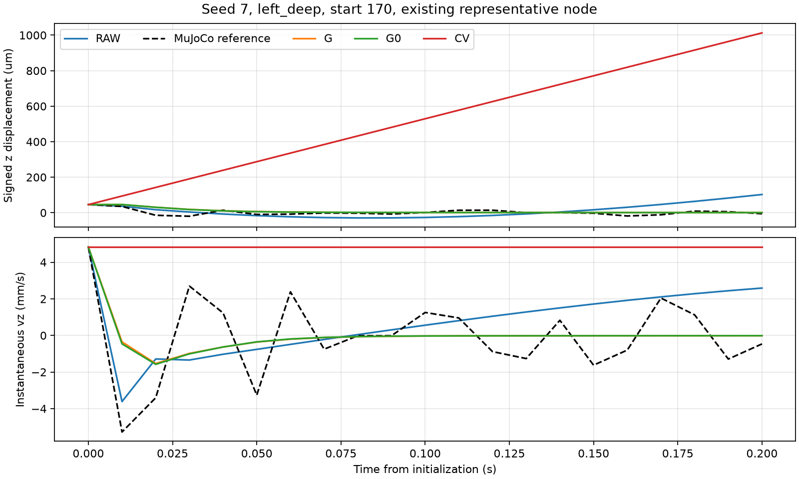

# A：训练预算与 B：解析力输入消融

**实测结论：增加训练改善了汇总位置，但汇总瞬时速度与接触帧位置精度退化；完整G也没有显示出相对G0的稳定额外收益。**不能将联合分数下降解释为动力学全面通过。

本轮比较同一2000更新轨迹的前缀，并从头训练G0去力组。数据、网络、损失、归一化、选模和评价掩码固定。

RAW/G/G0各种子7、17、27，共9次训练；所有名义参数量45324。G0保留G几何、法向、偏移与门控，三个力输入通道置零，有384个首层输入权重不被激活。此为输入贡献消融，不代表有效输入容量完全相同；G0可从几何间接推断力。
G0标签仍由原MuJoCo动力学产生；不是让软块在无物理力环境下运动。G使用既有拓扑辅助连续接触表面，并非纯Gaussian球并集。

训练均为三步AR、batch16、LR=0.0001、速度权重0.5、网格权重0.001。前缀最佳权重仅使用截至该前缀的五步共同验证目标，包含第0步。同时保存并评价精确2000步权重，避免选模掩盖末端退化。旧200更新余弦实验不是新长轨迹的匹配前缀。
中央600个普通帧对、108条分支（2160个帧对）、90个初始响应对不变；左侧用于开发验证，右侧未加载。软体仅在rollout起点读取真值状态，压头实测轨迹为已知外部输入。当前几何/力用预测状态的停止梯度副本计算；状态特征仍可微，不宣称穿过接触查询全程可微。位置和端点瞬时速度分别预测与监督，底部固定。

## A：真实接触帧的一步误差

单位为位置增量μm、瞬时速度mm/s；均值±样本标准差，n=3。接触分组来自GT当前接触标记，不使用预测接触筛样本。

| 可用更新前缀 | 方法 | 接触位置误差 | 接触速度误差 | 通过硬物理筛选的种子数 |
| --- | --- | --- | --- | --- |
| prefix_200 | RAW | 34.49 ± 2.02 | 5.116 ± 1.52 | 3/3 |
| prefix_200 | G | 81.34 ± 13.1 | 13 ± 1.78 | 3/3 |
| prefix_200 | G0 | 80.92 ± 12.9 | 12.95 ± 1.82 | 3/3 |
| prefix_200 | CV | 13.34 ± 0 | 2.167 ± 0 | 3/3 |
| prefix_500 | RAW | 37.34 ± 2.06 | 6.642 ± 0.223 | 3/3 |
| prefix_500 | G | 107.2 ± 3.39 | 11.42 ± 0.53 | 3/3 |
| prefix_500 | G0 | 106.1 ± 3.6 | 11.25 ± 0.436 | 3/3 |
| prefix_500 | CV | 13.34 ± 0 | 2.167 ± 0 | 3/3 |
| prefix_1000 | RAW | 37.34 ± 2.06 | 6.642 ± 0.223 | 3/3 |
| prefix_1000 | G | 107.2 ± 3.39 | 11.42 ± 0.53 | 3/3 |
| prefix_1000 | G0 | 106.1 ± 3.6 | 11.25 ± 0.436 | 3/3 |
| prefix_1000 | CV | 13.34 ± 0 | 2.167 ± 0 | 3/3 |
| prefix_2000 | RAW | 37.34 ± 2.06 | 6.642 ± 0.223 | 3/3 |
| prefix_2000 | G | 107.2 ± 3.39 | 11.42 ± 0.53 | 3/3 |
| prefix_2000 | G0 | 106.1 ± 3.6 | 11.25 ± 0.436 | 3/3 |
| prefix_2000 | CV | 13.34 ± 0 | 2.167 ± 0 | 3/3 |
| exact_2000 | RAW | 82.44 ± 18.6 | 14.74 ± 3.27 | 3/3 |
| exact_2000 | G | 233.6 ± 7.35 | 26.93 ± 0.412 | 3/3 |
| exact_2000 | G0 | 217.4 ± 6.62 | 24.87 ± 0.526 | 3/3 |
| exact_2000 | CV | 13.34 ± 0 | 2.167 ± 0 | 3/3 |

全部九次训练实际完成2000更新；RAW三种子选中500/400/450步，G与G0均选中500步。所以prefix_500、1000、2000的权重与指标相同，这是保留前缀内最佳权重的结果。

### 汇总位置与速度的权衡

按压/保持/释放/恢复、活动区/ROI、5/10/20步分别等权聚合MSE，再开方还原单位。联合分数=0.5×位置MSE/(1mm)²+0.5×速度MSE/(0.1m/s)²；权重固定，但不保证两项都改善。

| 权重 | 方法 | 位置μm | 瞬时速度mm/s | 联合分数 |
| --- | --- | --- | --- | --- |
| prefix_200 | RAW | 624.2 ± 30.1 | 6.382 ± 0.304 | 0.1971 ± 0.0186 |
| prefix_200 | G | 504 ± 21.7 | 8.652 ± 0.938 | 0.1309 ± 0.0107 |
| prefix_200 | G0 | 495.5 ± 12 | 8.779 ± 0.912 | 0.1267 ± 0.0058 |
| prefix_200 | CV | 560 ± 0 | 6.161 ± 0 | 0.1587 ± 0 |
| prefix_2000 | RAW | 577.1 ± 13.2 | 6.215 ± 0.195 | 0.1685 ± 0.00769 |
| prefix_2000 | G | 362.3 ± 2.55 | 11.36 ± 1.08 | 0.07213 ± 0.00127 |
| prefix_2000 | G0 | 361.6 ± 8.5 | 10.51 ± 0.52 | 0.07092 ± 0.00364 |
| prefix_2000 | CV | 560 ± 0 | 6.161 ± 0 | 0.1587 ± 0 |
| exact_2000 | RAW | 926 ± 172 | 9.278 ± 1.39 | 0.4429 ± 0.166 |
| exact_2000 | G | 379.3 ± 7.95 | 25.75 ± 1.73 | 0.1052 ± 0.00712 |
| exact_2000 | G0 | 386 ± 11.3 | 23.96 ± 0.367 | 0.1033 ± 0.00499 |
| exact_2000 | CV | 560 ± 0 | 6.161 ± 0 | 0.1587 ± 0 |

G的匹配前缀200→2000，位置由约504降至362μm，但速度由8.65升至11.36mm/s；真实接触帧一步位置由81.3升至107.2μm。恒速对应13.34μm与2.17mm/s，接触精度仍明显更好。G接触帧速度13.00→11.42mm/s有所改善，仍落后恒速。精确2000步的G速度更差（汇总约25.75mm/s），表明继续训练未解决该问题。

## B：完整G相对去力G0

百分比为逐种子误差降低后再统计，正值表示完整G误差更低。

| 指标（prefix_2000） | G相对G0降低% 均值±标准差 |
| --- | --- |
| joint_score | -1.882 ± 5.19 |
| balanced_position_um | -0.2549 ± 2.94 |
| balanced_velocity_mm_s | -8.029 ± 6.79 |
| contact_position_active_um | -1.043 ± 1.43 |
| contact_velocity_active_mm_s | -1.516 ± 1.32 |

G与G0的汇总位置分别约362.3与361.6μm，速度11.36与10.51mm/s；当前实验未支持解析力通道提供稳定额外收益，也未证明统计等价或物理力无用。几何已携带穿透等信息、当前弹性力近似及力编码是否限制收益，仍是未区分的假设。

## 全部阶段与边界

| 20步活动区域阶段 | 方法 | 位置μm | 速度mm/s |
| --- | --- | --- | --- |
| press | RAW | 627.5 ± 15.8 | 3.882 ± 0.0922 |
| press | G | 406.5 ± 12.7 | 9.325 ± 2.58 |
| press | G0 | 413.4 ± 20.5 | 7.579 ± 0.91 |
| press | CV | 230.5 ± 3.48e-14 | 1.765 ± 0 |
| hold | RAW | 417.3 ± 28.9 | 3.438 ± 0.13 |
| hold | G | 476.1 ± 32.4 | 13 ± 5.54 |
| hold | G0 | 475.8 ± 33.9 | 10.04 ± 5.48 |
| hold | CV | 69.73 ± 0 | 0.3413 ± 0 |
| release | RAW | 755.4 ± 47.8 | 6.296 ± 0.18 |
| release | G | 192.3 ± 6.07 | 5.451 ± 0.0524 |
| release | G0 | 193.3 ± 5.33 | 5.437 ± 0.0563 |
| release | CV | 1209 ± 0 | 7.972 ± 0 |
| recover | RAW | 903.7 ± 37.5 | 5.187 ± 0.507 |
| recover | G | 21.85 ± 0.32 | 2.544 ± 0.000356 |
| recover | G0 | 21.84 ± 0.317 | 2.544 ± 0.000252 |
| recover | CV | 606.9 ± 0 | 2.411 ± 0 |

### faster_down方向与幅度

下表为prefix_2000、活动区、一步、三个预先固定干预状态。幅度比理想值为1；方向余弦描述干预响应差值，不是物体整体运动方向。恒速不响应压头变化，响应为零、方向未定义。

| 种子 | 方法 | 位置负方向/3 | 速度负方向/3 | 位置幅度比均值 | 速度幅度比均值 |
| --- | --- | --- | --- | --- | --- |
| 7 | RAW | 0 | 0 | 1.27 | 1.94 |
| 7 | G | 3 | 3 | 2.61 | 1.87 |
| 7 | G0 | 3 | 3 | 2.21 | 1.75 |
| 17 | RAW | 3 | 0 | 0.782 | 0.804 |
| 17 | G | 0 | 0 | 4.12 | 4.19 |
| 17 | G0 | 0 | 0 | 3.76 | 3.78 |
| 27 | RAW | 0 | 0 | 0.871 | 1.18 |
| 27 | G | 3 | 3 | 2.12 | 2.24 |
| 27 | G0 | 3 | 3 | 2.04 | 2.3 |

G与G0在种子7、27的位置与速度响应均有3/3反向；种子17方向为正但幅度偏大。训练加长没有解决小速度干预机制。

单步ROI、5/10/20步、所有阶段、静止漂移、faster_down与其他干预、恢复波形均保存在各stage的评价目录。完整统计在metrics_summary.csv、phase_metrics_summary.csv、primary_interventions_summary.csv。阶段接触rollout标记指起点接触，不保证以后每步都接触。

中央teacher-forced诊断与固定16窗口AR探针是训练充分性的辅助证据，不是相同的损失，也不单独证明收敛。诊断回调逐次验证参数和RNG未改变。前缀最优验证分数单调降低是选择规则的结果，需结合原始检查点曲线。

**解释与局限：** 中央teacher-forced拟合持续改善，固定中央AR探针和左侧原始验证在后段却退化。这支持训练目标之间存在权衡，不能仅归咎于训练次数不足，也不能据此单独确定是过拟合还是状态表示不足。每组2000次更新全部触发既有梯度裁剪，此现象保留在训练日志，不在本轮据此追加调参。G/G0保持静止约束且释放位置有收益；恢复位置更接近仍不等于振动波形正确。左深恢复代表节点的幅度偏小，20步内预测周期不足，保留insufficient_cycles标记，不臆造相位精度。

本轮仍是左侧开发验证，无独立测试或实物验证；不能凭平均RMSE或去力消融宣称正确接触机制。

实际训练完成9/9。独立评分/网格复核：True。
全部评价窗口无翻转、非有限值或固定节点违规；这表示数值与边界检查通过，尚非动力学验证通过。

## 运行与复现

预算2小时、最多9次训练、两个CPU进程（每进程单线程）；训练和15套评价共2363.66秒（约39.4分钟）。9次均为首次执行成功，无失败或超时。A/B未改变网络、数据或选模规则，也未新增搜索配置。普通G调用次数的历史计数字段native_queries_training_and_selection实际计量条件查询；本轮真实MuJoCo原生接触查询由禁止调用检查确认始终为0，参见input_permission_checks.json。

入口：`python scripts/prepare_ab_training_force.py`，再运行`python scripts/run_ab_training_force.py`，完成后运行`python scripts/report_ab_training_force.py`。先激活项目.venv。已有目录不会覆盖，继续既有预算可用`--resume`；新一轮应复制配置并换独立目录。初始缓存依赖原公平主线及既有数据。准备脚本补齐评价输出父目录，记录在directory_preparation.json；未更改冻结科学代码或重启训练。

完整协议、样本与数据摘要见protocol.json、analysis_plan.json；逐次训练和评价见training_ledger.json、evaluation_ledger.json；独立重算评分、体积比与前缀选模见independent_verification.json。大权重和预测NPZ位于outputs/ab_training_force/run_001，沿用忽略规则；CSV/JSON/图随报告保存。

实测检查：`python -m pytest`全部246项通过，`ruff check .`通过。新增测试覆盖G0只去力、保留几何和门控、固定边界、梯度贯通、训练/推理一致及前缀禁止未来选模。45次诊断回调均未改变参数或RNG；9份重载权重与保存选择一致，60组方法评价独立复算通过。检查摘要见software_checks.json与independent_verification.json。

**下一项优先假设：** 当前位置与瞬时速度两支路的联合状态映射及响应监督，未能把接触条件转化为方向、幅度一致的动力学响应。下一轮应预先规定一个位置—速度一致性结构对照，并同时验收接触与小速度干预；本轮证据不支持继续单纯延长训练或宣称显式解析力已带来收益。

恢复说明图固定展示种子7、左深170窗口、沿用原评价器代表节点；并非挑选最好种子或片段。所有种子和恢复窗口的数据保留于recovery_metrics_per_seed.csv及各stage评价目录。
