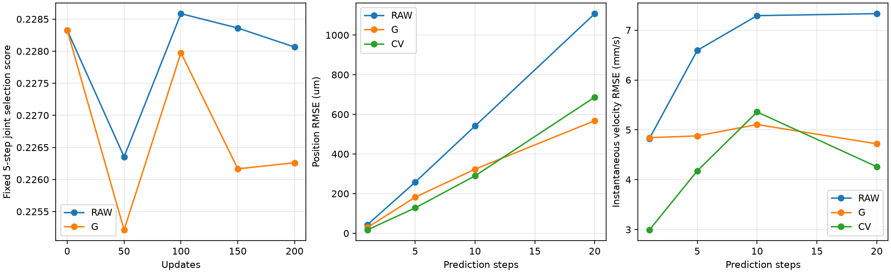
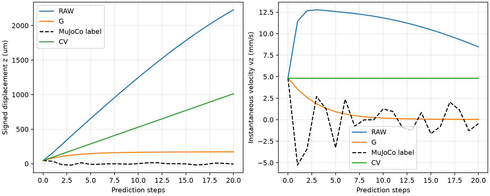

# 公平主线对照：RAW 与显式接触 G（短版）

本轮已实际完成两次从头训练和恒速对照。属于单种子、小预算开发验证，不是独立测试或全局最优搜索。

## 冻结设置与公平性

两组相同网络45324个参数、相同初始权重、固定空间编码、输出上限16mm/1.6m/s、种子7、三步自回归、200更新、batch16、Adam LR=0.0001、速度权重0.5、网格权重0.001。相同批次顺序、普通绝对监督+三步端点平均+初始成对响应监督，损失乘100和余弦调度一致。

RAW拥有当前软体x/v/rest、压头实际x/v和指令x/v，36维状态/相对运动编码，外支路门控恒为1。G使用已有拓扑辅助接触表面、固定中央标定点式解析力及接触门控。两组都从头训练，RAW不是冻结模型的输入置零消融；G训练缓存与自回归均重新计算G条件。

这比较的是整体输入表示与门控归纳偏置：G有已知拓扑、标定力律及接触外零响应先验。不能把结果只归因于力特征，相同参数量也不保证相同优化难度。G是拓扑辅助表面，尚非纯Gaussian球并集。

固定中央600普通帧对、108分支及90成对响应标签；左侧普通轨迹和18分支作开发验证，右侧数组未读取。真实下一帧只作监督/评分；压头轨迹已知，软体状态自由递推。历史M输入上下文和门控在两组中均被替换，前向原生接触/力查询次数为0。

五步共同目标包含第0步，50更新检查一次，两组均选中第50更新；最终统一评价1/5/10/20步。所有方法共享GT定义的评价掩码和四阶段/两区域/预测步长等权规则，不删除失败窗口。

## 实测收益与代价

G相对RAW的汇总位置RMSE降低29.06%，瞬时速度RMSE降低18.56%。相对CV位置降低5.05%，速度反而增加1.01%。

| 方法 | 固定联合分数 | 等权位置RMSE μm | 速度RMSE mm/s | 翻转状态/窗口 | 最低体积比 |
| --- | --- | --- | --- | --- | --- |
| RAW | 0.283809 | 749.519 | 7.641 | 0/0 | 0.605246 |
| G | 0.143307 | 531.734 | 6.223 | 0/0 | 0.601656 |
| CV | 0.158691 | 559.987 | 6.161 | 0/0 | 0.605137 |

均通过有限性、固定边界和网格翻转硬筛选；这不包含静止漂移或干预方向正确性。

| 静止对照 | 最大位移μm | 最大瞬时速度mm/s |
| --- | --- | --- |
| RAW | 1658.75 | 9.93081 |
| G | 7.2206e-10 | 4.42928e-12 |
| CV | 7.2206e-10 | 4.42928e-12 |

RAW在无接触对照出现明显漂移，G/CV接近数值零。这与显式门控/静止平衡先验的作用一致，尚不能据此证明学到了正确接触响应。

| 步数 | 区域 | RAW位置μm | G位置μm | CV位置μm | RAW速度mm/s | G速度mm/s | CV速度mm/s |
| --- | --- | --- | --- | --- | --- | --- | --- |
| 1 | active | 42.676 | 28.970 | 16.952 | 4.826 | 4.843 | 2.993 |
| 1 | contact_neighborhood | 47.218 | 47.912 | 22.720 | 5.405 | 7.529 | 3.865 |
| 5 | active | 258.004 | 182.021 | 127.978 | 6.594 | 4.879 | 4.177 |
| 5 | contact_neighborhood | 302.566 | 303.853 | 145.523 | 7.393 | 7.293 | 5.784 |
| 10 | active | 541.083 | 323.434 | 289.607 | 7.291 | 5.106 | 5.359 |
| 10 | contact_neighborhood | 600.482 | 540.601 | 391.565 | 8.698 | 7.814 | 9.301 |
| 20 | active | 1108.087 | 567.874 | 686.799 | 7.331 | 4.719 | 4.260 |
| 20 | contact_neighborhood | 1153.844 | 922.847 | 1065.396 | 8.347 | 6.778 | 6.592 |

上述RMSE先对四阶段MSE等权再开方，一步位置为增量RMSE。全部按压、保持、释放、恢复及两区域在phase_metrics.csv；接近/静止和完整轨迹指标在evaluation/。

G没有在全部单项上胜过RAW：一步ROI速度为7.529对5.405mm/s，五步ROI位置为303.853对302.566μm，均略差或更差。相对CV，G按压/保持仍明显退化，汇总改善不能代替这些阶段的正确性。

| 活动区域阶段 | 步数 | RAW位置μm | G位置μm | CV位置μm | RAW速度mm/s | G速度mm/s | CV速度mm/s |
| --- | --- | --- | --- | --- | --- | --- | --- |
| press | 5 | 191.694 | 175.846 | 59.088 | 4.579 | 6.563 | 1.180 |
| press | 10 | 407.409 | 396.834 | 111.037 | 4.555 | 6.611 | 1.062 |
| press | 20 | 796.463 | 819.718 | 230.501 | 3.548 | 7.429 | 1.765 |
| hold | 5 | 100.356 | 133.109 | 17.333 | 2.434 | 1.167 | 0.376 |
| hold | 10 | 215.950 | 129.000 | 34.164 | 2.293 | 0.917 | 0.272 |
| hold | 20 | 439.078 | 225.829 | 69.734 | 2.225 | 0.717 | 0.341 |
| release | 5 | 427.891 | 283.942 | 197.683 | 10.794 | 6.409 | 6.514 |
| release | 10 | 897.176 | 489.707 | 476.615 | 12.617 | 7.161 | 10.344 |
| release | 20 | 1860.831 | 749.788 | 1208.513 | 13.071 | 5.177 | 7.972 |
| recover | 5 | 190.670 | 57.123 | 150.478 | 5.523 | 3.115 | 5.080 |
| recover | 10 | 391.845 | 67.141 | 307.947 | 5.237 | 2.911 | 2.581 |
| recover | 20 | 788.411 | 69.313 | 606.857 | 5.152 | 2.567 | 2.411 |

## 干预与恢复：仍失败的部分

| faster_down起点 | 方法 | 位置方向余弦 | 速度方向余弦 | 位置幅度比 | 速度幅度比 |
| --- | --- | --- | --- | --- | --- |
| 70 | RAW | -0.2815 | -0.3693 | 1.9959 | 1.4501 |
| 70 | G | -0.0895 | 0.3017 | 0.2008 | 0.1665 |
| 70 | CV | 未定义（零响应） | 未定义（零响应） | 0.0000 | 0.0000 |
| 110 | RAW | -0.2806 | -0.3630 | 1.9100 | 1.5765 |
| 110 | G | -0.1492 | 0.2829 | 0.1849 | 0.1729 |
| 110 | CV | 未定义（零响应） | 未定义（零响应） | 0.0000 | 0.0000 |
| 150 | RAW | -0.2794 | -0.3692 | 1.9688 | 1.5344 |
| 150 | G | -0.3789 | 0.2427 | 0.1679 | 0.1268 |
| 150 | CV | 未定义（零响应） | 未定义（零响应） | 0.0000 | 0.0000 |

RAW和G的三例faster_down位置方向均为负；G速度方向为正但幅度偏低。CV的方向在零响应时未定义，不能计为机制通过。所有五类干预及多步结果完整保留在evaluation/response_evaluation/。

恢复有符号位移/瞬时速度、幅度和相位可识别状态保存在evaluation/recovery/。代表点仍不能正确重现回弹振动和静止形状；低于CV的漂移不等于恢复动力学正确。不足两个可识别周期时，相位保持未验证。

## 运行与检查

从本轮开始到训练/评价结束墙钟433.41s，含实现和预检；两组均200更新，但G需要重算接触，不能将相同更新数称作相同计算量。

| 模型 | 训练秒数 | 含缓存/重载秒数 | 梯度裁剪更新数 |
| --- | --- | --- | --- |
| RAW | 13.728 | 16.892 | 200/200 |
| G | 25.608 | 31.846 | 200/200 |

两组三步末端到第一步梯度有限且非零，训练与推理前向逐位一致，实际权重20步保存重载一致。独立NumPy重算每方法24评分单元及35普通+18干预网格窗口通过，145个冻结输入摘要无变化。233项测试及Ruff通过。原生查询被运行时禁止，实际调用0次。

原始冻结协议保留。继承模板的fixed.training_condition=M描述不适用本轮，以冻结的RAW_condition/G_condition及执行路径为准；旧训练日志的native_queries字段计数条件构建调用，不是原生查询。两处描述在metadata_clarifications.json明确澄清，不改训练、选模和评分。

## 结论与边界

预算内观察：G比这次RAW学习基线误差更低，并避免了静止漂移；相对CV收益有限且分阶段不一致。可重复性：当前仅种子7，没有多种子支持。机制：faster_down位置方向和恢复波形仍失败。独立测试：未验证，左侧仅开发验证。

这是一轮相同短预算下的整体方法对照，不能说明RAW已充分训练，不能将全部收益归于接触力，也不能声称显式模型理解物理或已解决泛化。下一轮优先固定本协议做多种子复核，再决定哪些收益值得独立测试；不根据本轮结果追加参数搜索。

训练入口：`python scripts/run_fair_mainline.py`（已运行目录拒绝覆盖）。重建审计和图表：`python scripts/report_fair_mainline.py`。完整输入缓存、检查点、预测NPZ和源快照位于忽略的outputs/fair_mainline/run_001/。

