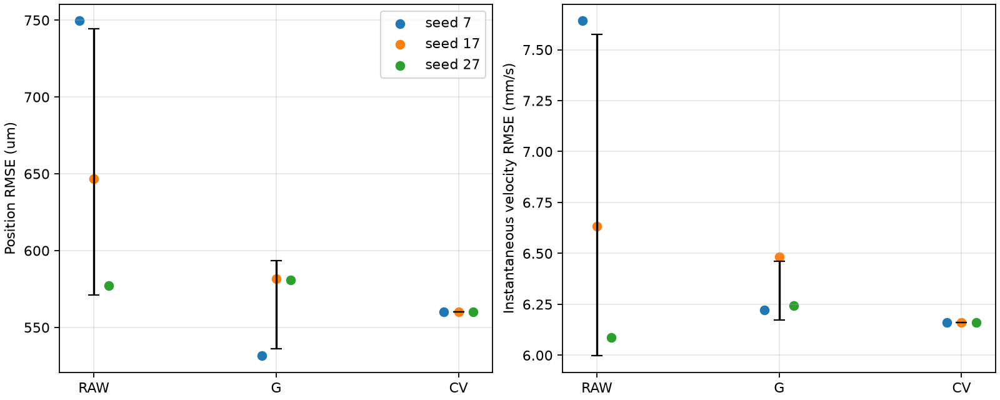
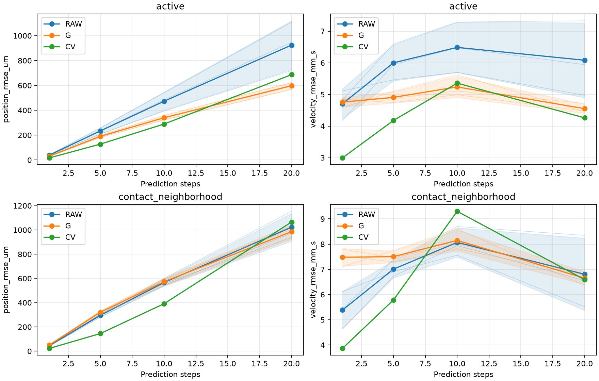
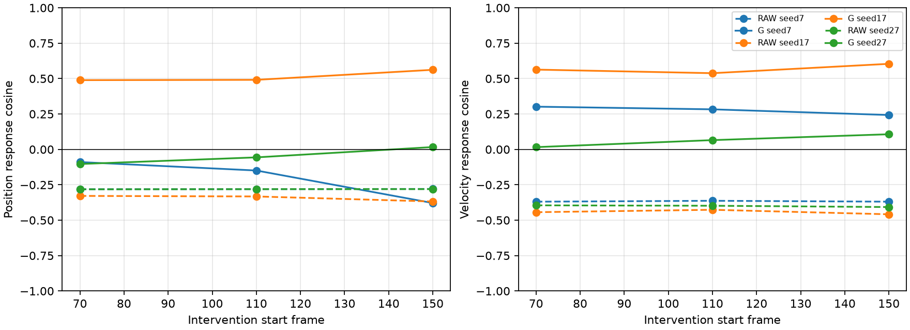

# 公平主线对照：三种子复核

已完成RAW/G在种子17、27的四次新增训练；种子7沿用原记录，未重训或覆盖。本轮没有搜索参数，仍是小预算开发验证，独立测试未验证。

## 协议与统计

网络45324参数、三步展开、200更新、batch16、LR=0.0001、速度权重0.5、网格权重0.001、损失/选模/掩码/数据划分全部固定。同种子RAW/G共享初始权重和批次；跨种子改变初始化和批次随机性。G自由递推重算当前接触与解析力，前向不读原生接触/力。当前输入缓存只读复用原先验证的确定性编码。

每个种子先独立评价，再计算均值和样本标准差（ddof=1）。误差汇总依旧按四阶段、两区域、5/10/20步等权；不先平均预测再评分，不丢弃失败或退化种子。标准差不是置信区间，n=3不作显著性声明。CV为同一个确定性参照，重复评价只用于一致性核查，±0不是泛化不确定性估计。

## 全部种子的实际结果

| 种子 | 方法 | 联合分数 | 位置RMSE μm | 速度RMSE mm/s | 选中更新 | 翻转状态/窗口 | 最低体积比 |
| --- | --- | --- | --- | --- | --- | --- | --- |
| 7 | RAW | 0.283809 | 749.519 | 7.641 | 50 | 0/0 | 0.605246 |
| 7 | G | 0.143307 | 531.734 | 6.223 | 50 | 0/0 | 0.601656 |
| 7 | CV | 0.158691 | 559.987 | 6.161 | None | 0/0 | 0.605137 |
| 17 | RAW | 0.211436 | 646.896 | 6.632 | 50 | 0/0 | 0.605246 |
| 17 | G | 0.171301 | 581.722 | 6.482 | 50 | 0/0 | 0.605246 |
| 17 | CV | 0.158691 | 559.987 | 6.161 | None | 0/0 | 0.605137 |
| 27 | RAW | 0.168499 | 577.314 | 6.088 | 100 | 0/0 | 0.605246 |
| 27 | G | 0.170703 | 580.953 | 6.245 | 50 | 0/0 | 0.605028 |
| 27 | CV | 0.158691 | 559.987 | 6.161 | None | 0/0 | 0.605137 |

| 方法 | 联合分数 均值±样本标准差 | 位置μm | 速度mm/s | 静止对照最大位移μm |
| --- | --- | --- | --- | --- |
| RAW | 0.2212 ± 0.0583 | 657.9 ± 86.6 | 6.787 ± 0.788 | 1516 ± 281 |
| G | 0.1618 ± 0.016 | 564.8 ± 28.6 | 6.317 ± 0.144 | 7.221e-10 ± 0 |
| CV | 0.1587 ± 0 | 560 ± 0 | 6.161 ± 0 | 7.221e-10 ± 0 |

## 成对收益是否复现

以下是每个种子的误差降低百分比，再跨种子统计；正值改善、负值退化。它不同于直接拿两组均值作比值。

| 对照 | 位置降低% 均值±标准差 | 速度降低% 均值±标准差 | G位置较优种子数 | G速度较优种子数 |
| --- | --- | --- | --- | --- |
| RAW | 12.83 ± 15.03 | 6.08 ± 11.07 | 2/3 | 2/3 |
| CV | -0.86 ± 5.11 | -2.53 ± 2.33 | 1/3 | 0/3 |

种子7的G位置优势没有在两个新增种子相对CV复现；G速度三种子均未超过CV。这里指四阶段/区域/时域等权汇总。相对RAW，G在种子7和17较优，在种子27略差，不能声称汇总指标稳定领先。

## 阶段、时域与机制局限

单步及5/10/20步、两区域的完整均值/标准差见balanced_metrics_summary.csv，四个主阶段见phase_metrics_summary.csv；以下列出20步活动区域，避免只展示汇总分数。接近与静止不参与主分数，完整评价分别保存在原种子7目录及seed_17/seed_27/evaluation/。

| 阶段 | 方法 | 位置μm 均值±标准差 | 速度mm/s 均值±标准差 |
| --- | --- | --- | --- |
| press | RAW | 794.6 ± 60.6 | 3.773 ± 0.199 |
| press | G | 844.6 ± 21.7 | 6.748 ± 0.665 |
| press | CV | 230.5 ± 3.48e-14 | 1.765 ± 0 |
| hold | RAW | 522 ± 129 | 2.928 ± 0.611 |
| hold | G | 366.4 ± 181 | 1.544 ± 0.998 |
| hold | CV | 69.73 ± 0 | 0.3413 ± 0 |
| release | RAW | 1407 ± 485 | 10.03 ± 3.02 |
| release | G | 744.5 ± 47.5 | 5.239 ± 0.0982 |
| release | CV | 1209 ± 0 | 7.972 ± 0 |
| recover | RAW | 672.4 ± 146 | 4.648 ± 0.701 |
| recover | G | 73.51 ± 9.26 | 2.564 ± 0.00431 |
| recover | CV | 606.9 ± 0 | 2.411 ± 0 |

局部收益也有重复出现：20步活动区域中，G在释放阶段的位置和速度、恢复阶段的位置，均有3/3种子优于CV；恢复速度仍3/3更差，按压/保持的位置和速度均3/3更差。这说明收益有明确阶段边界，而非所有收益都未复现。完整逐阶段胜出计数在phase_win_counts.csv。

| 种子 | 方法 | faster_down位置负方向/例数 | 速度负方向/例数 | 位置幅度比均值 | 速度幅度比均值 |
| --- | --- | --- | --- | --- | --- |
| 7 | RAW | 3/3 | 3/3 | 1.958 | 1.520 |
| 7 | G | 3/3 | 0/3 | 0.185 | 0.155 |
| 7 | CV | 0/3 | 0/3 | 0.000 | 0.000 |
| 17 | RAW | 3/3 | 3/3 | 2.361 | 1.758 |
| 17 | G | 0/3 | 0/3 | 0.583 | 0.562 |
| 17 | CV | 0/3 | 0/3 | 0.000 | 0.000 |
| 27 | RAW | 3/3 | 3/3 | 1.327 | 1.189 |
| 27 | G | 2/3 | 0/3 | 0.244 | 0.213 |
| 27 | CV | 0/3 | 0/3 | 0.000 | 0.000 |

G的位置方向在种子17三例均为正，种子7三例均为负，种子27两例为负；这说明机制响应明显依赖种子。方向为正也不等于幅度正确或完整机制通过。CV零响应的方向未定义，表中的0个负方向不代表通过，详见faster_down_direction_counts.csv的undefined列。

全部五类干预、响应幅度及恢复偏差/幅度/相位可识别状态均跨种子保存。不足周期或零响应的方向/相位不填0。网格有限性、固定边界和无翻转与机制正确性分开判断。G静止对照不漂移来自门控/静止参考先验；RAW漂移和两模型恢复波形的偏差继续保留。

## 运行与检查

四次新增训练均完成200更新，无算法失败或超时；所有种子/方法评价窗口无翻转。每个方法每个种子35个普通及18个干预窗口，失败窗口没有删除。包括种子7的全部评分与网格均用独立NumPy复核，CV跨种子预测逐位一致。原报告、权重、数据和缓存摘要不变；右侧数组未加载。242项测试和Ruff通过。

| 新种子 | 方法 | 训练秒数 | 含重载秒数 |
| --- | --- | --- | --- |
| 17 | RAW | 11.999 | 12.732 |
| 17 | G | 25.574 | 25.658 |
| 27 | RAW | 11.390 | 11.418 |
| 27 | G | 24.999 | 25.076 |

## 本轮结论

1. 数值有效性在本轮六个模型中得到重复观察，静止先验的约束作用也保持。
2. G相对RAW的平均收益存在，但不是每个种子都领先；相对CV的汇总稳定优势未得到支持。释放20步位置/速度及恢复位置的局部收益在3/3种子重复出现。
3. faster_down的位置方向随种子变化，恢复波形仍未验证正确；不能宣布可靠接触动力学。
4. 左侧仍是开发验证，没有独立测试结论；不根据本轮复核结果追加参数搜索或挑选最好种子。

这轮重复的是同一短预算训练流程，不能证明模型充分收敛，也不能把平均收益全部归于解析力。后续应围绕主线预先规定训练预算和公平基线的充分性检查，再冻结方法作独立评价。

入口：`python scripts/replicate_fair_mainline.py`（已有运行拒绝覆盖）。只重建审计、统计与图：`python scripts/report_fair_mainline_multiseed.py`。新权重、预测和源码快照位于outputs/fair_mainline_multiseed/run_001/。

