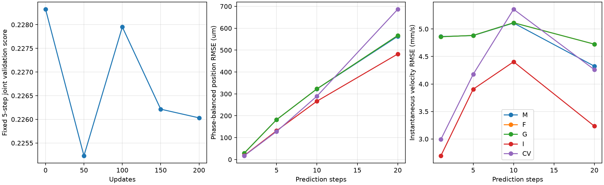
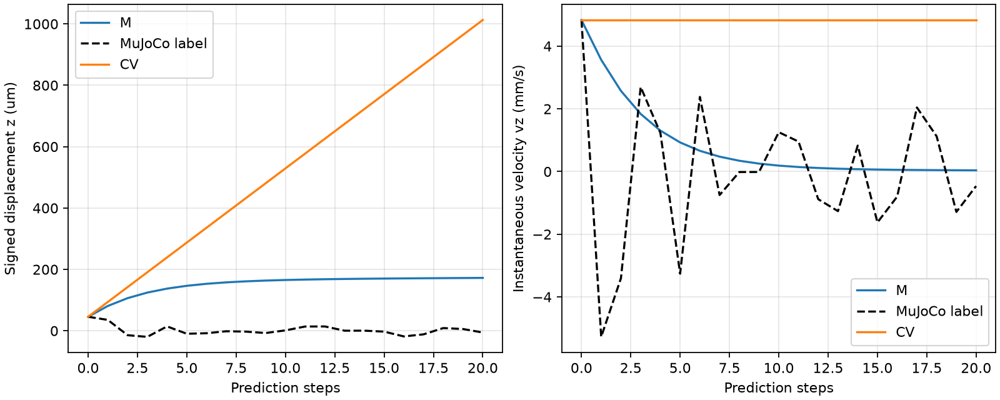

# 三步自回归短实验：已实际运行

本轮是单配置、单种子的短程训练流程诊断，不是十二配置搜索或独立测试。

复用冻结候选S08：种子7、三步展开、LR=0.0001、速度权重0.5、网格权重0.001；batch16、200次更新。200次余弦调度压缩到本轮预算，并不等同于原2000次的前200次。

实际完成200次更新，训练20.571s；训练及M/F/G/I/CV评价共107.791s（不含后验报告整理）。新预算15分钟；旧run_001六小时停止证据未覆盖。

五步共同目标包含第0步，从0.22832608降到0.22522996，选中第50次更新，下降1.36%。

## 主要实测结果

M相对恒速：固定联合分数下降11.08%，等权汇总位置RMSE下降5.75%，瞬时速度RMSE下降1.65%。联合分数下降百分比与RMSE下降百分比不是同一量。

| 方法 | 联合分数 | 位置分数 | 速度分数 | 翻转状态/窗口 | 最低体积比 |
| --- | --- | --- | --- | --- | --- |
| M | 0.141108 | 0.278545 | 0.003671 | 0/0 | 0.601442 |
| F | 0.142688 | 0.281497 | 0.003878 | 0/0 | 0.601479 |
| G | 0.142688 | 0.281497 | 0.003878 | 0/0 | 0.601479 |
| I | 0.127169 | 0.251548 | 0.002789 | 0/0 | 0.605246 |
| CV | 0.158691 | 0.313586 | 0.003795 | 0/0 | 0.605137 |

M为原生几何+原生力；F为原生几何+解析力；G为修正接触表面+解析力。I屏蔽接触输入，属于冻结权重的输入消融，不能称公平重训基线。所有方法通过本轮物理筛选，严格固定节点，评价掩码相同，失败窗口未删除。

| 步数 | 区域 | M位置RMSE μm | CV位置RMSE μm | M速度RMSE mm/s | CV速度RMSE mm/s |
| --- | --- | --- | --- | --- | --- |
| 1 | active | 29.213 | 16.952 | 4.863 | 2.993 |
| 1 | contact_neighborhood | 48.461 | 22.720 | 7.567 | 3.865 |
| 5 | active | 182.057 | 127.978 | 4.880 | 4.177 |
| 5 | contact_neighborhood | 303.788 | 145.523 | 7.288 | 5.784 |
| 10 | active | 322.583 | 289.607 | 5.109 | 5.359 |
| 10 | contact_neighborhood | 538.667 | 391.565 | 7.813 | 9.301 |
| 20 | active | 563.091 | 686.799 | 4.323 | 4.260 |
| 20 | contact_neighborhood | 913.535 | 1065.396 | 6.124 | 6.592 |

M在一步、五步的两区域位置与速度都比CV差；10步位置也更差。20步活动区域位置改善约18%，速度仍略差；不能只展示汇总改善。

| 阶段（活动区域） | 步数 | M位置μm | CV位置μm | M速度mm/s | CV速度mm/s |
| --- | --- | --- | --- | --- | --- |
| press | 5 | 175.041 | 59.088 | 6.579 | 1.180 |
| press | 10 | 394.574 | 111.037 | 6.621 | 1.062 |
| press | 20 | 808.170 | 230.501 | 6.394 | 1.765 |
| hold | 5 | 134.521 | 17.333 | 1.171 | 0.376 |
| hold | 10 | 130.184 | 34.164 | 0.918 | 0.272 |
| hold | 20 | 225.680 | 69.734 | 0.706 | 0.341 |
| release | 5 | 283.863 | 197.683 | 6.395 | 6.514 |
| release | 10 | 488.967 | 476.615 | 7.159 | 10.344 |
| release | 20 | 747.934 | 1208.513 | 5.177 | 7.972 |
| recover | 5 | 57.147 | 150.478 | 3.115 | 5.080 |
| recover | 10 | 67.187 | 307.947 | 2.910 | 2.581 |
| recover | 20 | 69.363 | 606.857 | 2.567 | 2.411 |

表中先按压/保持/释放/恢复四阶段MSE等权，再开方；一步位置栏是增量RMSE。全部分阶段、活动/ROI、接近/静止、干预和恢复CSV保存在final_routes/。

## 局限与解释

M的一步faster_down活动区域位置方向余弦为-0.07120768286128261, -0.12920110800252704, -0.3543342245067975，仍有3/3为负。速度方向为正，但响应幅度也未恢复到真值。联合分数改善不代表接触机制验收通过。

收益主要出现在释放/恢复的位置误差，按压/保持的位置和速度普遍退化。F/G相对CV的汇总速度RMSE也增加约1.09%，不能说三路线都同时改善位置和速度。

I的平均位置和速度误差均低于M，表明本轮接触输入并未带来对应绝对误差收益。I对压头干预的一步响应为零，这也不能称为具有正确接触因果响应。F与G在当前精度下接近，不能据此断言几何近似已经解决所有情况。

恢复有符号位移与瞬时速度、半峰峰幅度和偏差保存在恢复CSV中。M和CV的30个恢复通道的预测/真值未同时具备至少两个可识别周期，相位/滞后未验证，不填作0。
图中固定材料点在20步时，预测z位移为172.35μm，真值为-5.61μm；预测速度衰减后仍留有位移偏差，降低恒速漂移并不等于恢复到静止形状。

仅三步训练、选中50次更新、单种子和反复使用的左侧开发验证，尚不能把观察到的改善归因于网格惩罚或多步训练，也不能与2000次历史模型做公平训练预算比较。没有新增数据、网络结构、频率或参数池。右侧数组未加载，独立测试未验证，多种子未运行。

下一项可检验的问题是：在相同三步、200更新预算下，对比接触输入是否引入绝对状态偏差，并同时保留干预响应检验。暂不据本轮追加自动搜索或修改物理有效性门槛。

## 检查与复现

五步末端到第一步位置/速度梯度有限且非零；原生求解器只提供停止梯度的当前条件。位置与瞬时速度独立监督；后续真实软体状态只评分、不回填。保存重载位置/速度逐位一致；独立NumPy复算每方法24评分单元及35普通+18干预网格窗口通过，145个数据摘要无变化。

训练入口：`python scripts/run_short_multistep.py`。已运行目录禁止重复训练覆盖；大检查点/NPZ在`outputs/short_multistep/run_001/`。仅重建审计、表格与图：`python scripts/report_short_multistep.py`。

